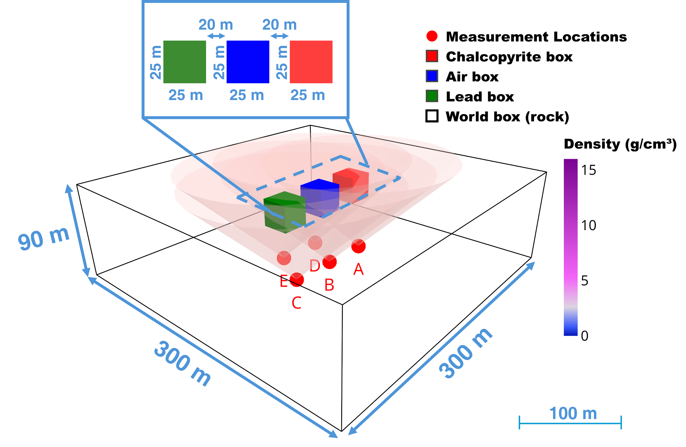

# Musae — User Manual

## 1. Build & Runtime Environment

### 1.1 Dependencies

**Musae-main:**

| Dependency | Minimum Version | Notes |
|---|---|---|
| C++ Compiler | GCC ≥ 13 or Clang ≥ 17 | Required for `std::format` |
| CMake | ≥ 3.21 | |
| MPI | ≥ 3.1 (OpenMPI or MPICH) | `sudo apt install libopenmpi-dev` |
| Eigen | ≥ 3.4.0 | `sudo apt install libeigen3-dev` |
| Geant4 | ≥ 11.0.0 | Must enable GDML: `-DGEANT4_USE_GDML=ON` |
| ROOT | ≥ 6.30.00 | See [ROOT install guide](https://root.cern.ch/install/) |
| Mustard | 0.25.114 (custom) | Automatically downloaded by CMake |

**MuCT (Python notebooks):**
- Python ≥ 3.9
- See `MuCT/requirements_muCT.txt` for the full package list
- Key packages: numpy, scipy, pandas, numba, matplotlib, trimesh, plotly, pyvista, laspy, kaleido, imageio, jupyter

**MuCT desktop GUI (optional):**
- PyQt5 ≥ 5.15
- VTK ≥ 9.2
- Both are included in `MuCT/requirements_muCT.txt`; the GUI is documented in Section 3.3

### 1.2 Installing System Dependencies

```bash
# Ubuntu / Debian
sudo apt install build-essential cmake libopenmpi-dev libeigen3-dev \
    libx11-dev libxext-dev libxft-dev libxpm-dev \
    libgl-dev libglu-dev qt6-base-dev qt6-base-dev-tools \
    libxerces-c-dev libexpat1-dev zlib1g-dev libfreetype-dev
```

### 1.3 Installing Geant4

Refer to the [official Geant4 installation guide](https://geant4-userdoc.web.cern.ch/UsersGuides/InstallationGuide/html/) for detailed instructions. A minimal build suitable for Musae:

```bash
# Download Geant4 source
wget https://gitlab.cern.ch/geant4/geant4/-/archive/v11.4.1/geant4-v11.4.1.tar.gz
tar xzf geant4-v11.4.1.tar.gz

# Configure and build (out-of-source)
mkdir -p geant4-v11.4.1-build geant4-v11.4.1-install
cd geant4-v11.4.1-build
cmake -DCMAKE_INSTALL_PREFIX=$PWD/../geant4-v11.4.1-install \
      -DGEANT4_USE_GDML=ON \
      -DGEANT4_USE_QT=ON \
      -DGEANT4_USE_OPENGL_X11=ON \
      -DGEANT4_BUILD_MULTITHREADED=ON \
      ../geant4-v11.4.1
make -j$(nproc)
make install
```

**Important:** `-DGEANT4_USE_GDML=ON` is **required** by Musae. Without it, compilation will fail with `G4GDMLParser.hh: No such file or directory`.

After installation, make CMake aware of Geant4 (choose **one** method):

**Method A — environment variable:**
```bash
export CMAKE_PREFIX_PATH=<geant4-install-dir>:$CMAKE_PREFIX_PATH
# Add to ~/.bashrc for persistence
```

**Method B — CMake argument per build:**
```bash
cmake .. -DGeant4_DIR=<geant4-install-dir>/lib/cmake/Geant4
```

For runtime, Geant4 shared libraries must be findable:
```bash
export LD_LIBRARY_PATH=<geant4-install-dir>/lib:$LD_LIBRARY_PATH
# Add to ~/.bashrc for persistence
```

### 1.4 Installing ROOT

Refer to the [official ROOT installation guide](https://root.cern.ch/install/). Pre-compiled binaries are recommended for most users. Make sure ROOT is discoverable by CMake (`ROOT_DIR` or `CMAKE_PREFIX_PATH`).

### 1.5 Installing a C++20 Compiler

This project requires GCC ≥ 13 or Clang ≥ 17 for `<format>` support. Older versions (e.g., GCC 11–12) set C++20 but lack this header and will fail with `fatal error: format: No such file or directory`.

**Ubuntu 22.04 / Debian 12:**
```bash
sudo apt update
sudo apt install gcc-13 g++-13
export CC=gcc-13 CXX=g++-13
```

**Ubuntu 24.04+ / Debian 13+:**
The default `g++` (≥ 13) works directly — no extra setup needed.

Verify after installation:
```bash
g++ --version   # should show 13.x or newer
```

If using Clang instead:
```bash
sudo apt install clang-17 libc++-17-dev libc++abi-17-dev
export CC=clang-17 CXX=clang++-17
```

### 1.6 Build Instructions

```bash
cd Musae-main
mkdir -p build && cd build
cmake .. -DMUSAE_BUILTIN_MUSTARD=ON -DCMAKE_POLICY_VERSION_MINIMUM=3.5
make -j$(nproc)
```

The built executable `Musae` will be located in `Musae-main/build/`.

### 1.7 Runtime Prerequisites

- All shell scripts in `scripts/` are designed to be run from the `build/` directory.
- **Important:** `Example1.md` and `Example2.md` are **reference guides**, not executable scripts. Open them in any markdown viewer (or `cat`) and copy/run each command individually. SimFlux (Step 2 in both examples) requires manual YAML editing between scenarios and cannot be fully automated.
- Input data paths in YAML and macro (`.mac`) files are relative to the `build/` directory.
- MPI is used for parallel event generation and simulation. Adjust `mpirun -np <N>` if needed.

---

## 2. Musae-main — MuSAE Toolset Overview

MuSAE (Muon Simulation and Analysis Engine) is the core C++/Geant4-based toolkit for cosmic-ray muon simulation and data analysis.

| Module | Function |
|---|---|
| **ReconLGA** | Reconstruct real experimental data from LGA (Large Granularity Array) detector raw files |
| **VisLGA** | Visualize and inspect real experimental LGA data |
| **GenCRMu** | Generate cosmic-ray muon events via EcoMug and store as ROOT files |
| **SimFlux** | Simulate muon transport through a user-defined geometry (described in YAML), producing simulated detector data |
| **AnaOpacity** | Analyze data from ReconLGA or SimFlux; compute survival fractions (opacity) binned by azimuth/zenith angle, and muon minimum-energy vs. mass-thickness distributions; output CSV for MuCT |
| **Projection** | Back-project muons onto a 2D plane and compute standardized residuals; suitable for small-scale scenarios where detector volume is not negligible relative to the density anomaly |

### 2.1 Common Command-line Patterns

All subprograms support `--help` for detailed options:
```bash
./Musae GenCRMu --help
./Musae SimFlux --help
./Musae AnaOpacity --help
./Musae Projection --help
```

---

## 3. MuCT — 3D Density Reconstruction & Visualization

The Python-based reconstruction module performs 3D density inversion from muon opacity data.

### 3.1 Key Notebooks

| Notebook | Purpose |
|---|---|
| `Example2_reconstruct.ipynb` | M-H (Metropolis-Hastings) 3D density inversion using opacity CSV data |
| `Example2_visualize.ipynb` | 3D visualization of reconstruction results with Plotly and PyVista |

For interactive inspection without Jupyter, use the desktop GUI described in Section 3.3.

### 3.2 Input Data

- Terrain elevation CSV placed in `MuCT/input/Terrain/`
- Opacity CSV output from AnaOpacity placed in `Musae-main/data/Csv_output/`
- Reconstruction `.npy` outputs with a same-name `.txt` parameter file
- Density CSV with one voxel center per row (`X`, `Y`, `Z`, `rho`)

### 3.3 Desktop Visualization GUI (mugui)

`MuCT/mugui` is an optional PyQt5 + VTK desktop application for viewing reconstruction products. It does not replace the notebooks; it is intended for fast inspection, comparison of reconstruction runs, and screenshot preparation.

#### 3.3.1 Installation and Launch

The GUI dependencies are part of `MuCT/requirements_muCT.txt`:

```bash
cd MuCT
python3 -m venv muCT_local
source muCT_local/bin/activate
pip install -r requirements_muCT.txt
muCT_local/bin/python mugui/main.py
```

If the environment already exists:

```bash
cd MuCT
muCT_local/bin/python mugui/main.py
# or, after activating the environment:
python mugui/main.py
```

`main.py` adds the virtual environment's Qt5 library directory to `LD_LIBRARY_PATH` before importing PyQt5. This avoids most `xcb` platform-plugin failures caused by mixing the system Qt5 with the PyQt5 wheel. The entry point also registers the bundled Noto Sans CJK SC font so Qt widgets and VTK labels can render Chinese text.

Top-level window titles are ASCII because the window manager draws title bars with its own font, which may not contain CJK glyphs. The application body and control labels are Chinese.

#### 3.3.2 Tabs and Data Formats

| Tab | Purpose | Accepted input |
|---|---|---|
| **Density Reconstruction** | Inspect 3D density voxels and optional terrain/geometry context | `.npy` + same-name `.txt`, or CSV with `X,Y,Z,rho` |
| **Terrain Reconstruction** | Inspect a reconstructed height surface and a true-terrain overlay | `.npy` + `.txt`, or CSV with `X,Y,height` |
| **Opacity Distribution** | Inspect angular opacity bins as radial columns from detectors | AnaOpacity CSV with `u,v,w,bincontent,error`; multi-select supported |

**Density data**

- `.npy` + `.txt`: the JSON parameter file must contain `N_X`, `N_Y`, `N_Z` and `X_MIN/X_MAX`, `Y_MIN/Y_MAX`, `Z_MIN/Z_MAX`. Voxels equal to `-1` are invalid.
- CSV: one row per voxel center with columns `X (m)`, `Y (m)`, `Z (m)`, `rho (g/cm3)`. A sparse CSV containing only valid voxels is accepted.
- The default option drops the first z layer, matching the notebook operation `rho[:,:,1:]`.

**Terrain data**

- `.npy` + `.txt`: the JSON file must contain `N_X`, `N_Y` and `X_MIN/X_MAX`, `Y_MIN/Y_MAX`. The value `-55` marks invalid cells and is rendered as a hole.
- CSV: columns `X`, `Y`, `height`; the table is pivoted into a regular grid.
- The Terrain tab does not load tunnel geometry or detector markers.

**Opacity data**

- CSV produced by `AnaOpacity`, with columns `u`, `v`, `w`, `bincontent`, and optional `error`. Column aliases such as `content`, `value`, `err`, and `uncertainty` are accepted.
- Multiple files can be loaded; each file represents one detector. The detector letter is parsed from the file name when possible (for example `SimBox_A_...` or `TianqinNewPbCube_A_...`).
- Each angular bin is drawn as a three-dimensional column from the detector position to an end cap at

  ```text
  r(v) = r_min + (r_max - r_min) * (v / vmax)^gamma
  ```

  where `gamma` is selectable as square root (0.5), fourth root (0.25), or linear (1.0). The end cap and four semi-transparent side faces are colored by mass thickness; four dark corner lines outline each column.
- Controls include `r_min`/`r_max`, gamma, colormap, color range, logarithmic color scale, hiding zero bins, bin subdivision (2x2 to 8x8), and detector marker radius.
- Detector spheres and labels are rendered in an overlay layer so they remain visible even when the columns enclose the detector origin.

#### 3.3.3 Controls

**Scene area (all tabs)**

- **Scene preset** selector: `Auto`, `SimBox`, `Tianqin`, or `Custom`.
- **Load true terrain CSV...**: assigns a true-terrain CSV to the current tab only. The current terrain file name is shown below the button.
- **Custom** detector editor: one `name x y z` entry per line. The editor is not applied while typing; click **Apply detector positions** to update the detector markers, opacity columns, and camera center.

**Density tab**

- Colormap, density range (`vmin`/`vmax`), minimum absolute-density threshold, transparent mode, and hidden interval.
- Drop-first-z option, true-terrain shell toggle and opacity, detector/auxiliary-geometry toggles, and axes marker.
- The threshold, transparency, and interval filters update the existing voxel grid without rebuilding it.

**Terrain tab**

- Median filter (3x3), Gaussian smoothing sigma, and invalid-value hole toggle.
- Height range, colormap (including terrain colors), and true-terrain overlay opacity.
- No tunnel or detector controls.

**Opacity tab**

- Per-file visibility checkboxes, file removal, `r_min`/`r_max`, gamma, colormap, color range, log scale, zero-bin hiding, subdivision, detector marker radius, true-terrain shell, auxiliary geometry, and axes marker.
- The file list checkboxes control visibility; clicking a row or its checkbox also selects it for removal.

**Common actions**

- Left-drag rotate, wheel zoom, middle-drag pan.
- **Reset camera** restores a useful default view. The Opacity tab uses an oblique side view so column heights are visible.
- **PNG screenshot** supports 1x, 2x, and 4x scaling.

#### 3.3.4 Scene Presets and True Terrain

Scene presets are stored in `MuCT/mugui/scene_presets.json`. Each preset contains detector positions, a view range, optional auxiliary geometry (world box or tunnel cuboids), and an optional true-terrain CSV.

- Presets are matched automatically from the data file name (`SimBox` or `Tianqin`).
- Selecting a preset explicitly keeps that selection when opacity files are loaded.
- An opacity file that matches no preset (for example `RuYuan_*`) does not inherit the previous preset scene. Any stale tunnel/detector geometry is cleared, the detector origin defaults to `(0,0,0)`, and manually loaded true terrain is preserved.
- Each tab can load a different true-terrain CSV. If a preset's terrain file is missing, the Scene label and the status bar report it; the viewer does not fabricate terrain.
- The Tianqin preset expects `MuCT/input/Terrain/Compress_data_NEW_2m_Nx880_Ny577.csv`. If that file is unavailable, place it at the expected path or select another file with the Scene-area button.

#### 3.3.5 Custom Detectors and Camera Centering

1. Select **Custom** in the Scene preset selector.
2. Enter one detector per line, for example:

   ```text
   A 0 0 0
   B -10 5 -2
   ```

3. Click **Apply detector positions**.

The positions are applied only after this click. The view updates detector markers, opacity column origins, and moves the camera center to the centroid of the entered detectors. If a view already exists, its current zoom is preserved and only the center is shifted. If no view exists yet, a default view is created around the detector centroid.

For opacity files without a recognizable detector letter, the first custom detector is used as the origin. Files with `A`, `B`, etc. in the name are matched to the corresponding custom detector.

#### 3.3.6 Interaction, Rendering Notes, and Troubleshooting

- **Qt platform plugin error** (`xcb`): confirm that `muCT_local/bin/python` is used. `main.py` prepends the bundled Qt5 libraries automatically; mixing system Qt5 with the wheel can still cause conflicts.
- **Missing PyQt5 or VTK**: install `PyQt5>=5.15` and `vtk>=9.2`, or reinstall `MuCT/requirements_muCT.txt`.
- **Density/opacity actors blank on software OpenGL**: density voxels and opacity bins use point scalars with per-cell vertices, avoiding a VTK 9.6/Mesa-llvmpipe issue with cell-scalar actors. Depth peeling is intentionally disabled because it can make large transparent surfaces disappear on llvmpipe.
- **Large true-terrain files**: the 880x577 terrain grid can take a few seconds to load. The current terrain file is shown in the Scene area; a missing file is reported instead of failing silently.
- **Chinese text in the GUI body**: the bundled `mugui/fonts/NotoSansCJKsc-Regular.otf` is registered at startup. VTK legend and label text load the same font file directly. The font is distributed under the SIL Open Font License 1.1; see `mugui/fonts/LICENSE-OFL.txt`.
- **Window title boxes**: top-level titles are ASCII. The window manager does not use the Qt application font, so a Chinese title would require a CJK font installed for the window manager itself.

---

## 4. Example 1 — Concrete Wall Cavity Detection

This example demonstrates muon transmission imaging of a concrete wall with an embedded cubic cavity.

**Workflow:** GenCRMu → SimFlux → AnaOpacity/Projection

### 4.1 Step-by-Step

#### Step 1: Generate Cosmic-Ray Muons (GenCRMu)
```bash
mpirun ./Musae GenCRMu 1000000000 -h 300 -t 0 0 0 -r 3 -p 0 -z 60 \
    -o ../data/GenCRMu/ConcreteWall_test.root -m RECREATE
```
- Generates 1×10⁹ muon events on a hemisphere of radius 3 m at height 300 m.
- `-p 0`: flat momentum spectrum.
- `-z 60`: maximum zenith angle 60°.

#### Step 2: Simulate Muon Transport (SimFlux)

Two scenarios are needed — wall **with** and **without** the cavity — to compute the standard deviation. The macro file (`Example1.mac`) controls the simulation via three key Geant4 UI commands:

| Macro command | Meaning |
|---|---|
| `/Mustard/Detector/Description/Import` | Path to the YAML geometry file |
| `/Mustard/Analysis/FilePath` | Output directory for simulation results |
| `/Mustard/Generator/FromDataPrimaryGenerator/EventData` | GenCRMu input ROOT files + generator type (`CRMu`) |

**Scenario A (with cavity):**
1. Edit `../scripts/Example1.yaml`: ensure the line with `ConcreteWallWithCubeHole0p7_Unit_mm.stl` is active and `ConcreteWall_Unit_mm.stl` is commented out.
2. Edit `../scripts/Example1.mac`: set `/Mustard/Analysis/FilePath` to `../data/SimFlux_vis/ConcreteWall_test`.
3. Run:
   ```bash
   mpirun ./Musae SimFlux ../scripts/Example1.mac
   ```

**Scenario B (without cavity):**
1. Edit `../scripts/Example1.yaml`: comment out the cavity STL and uncomment the solid wall STL.
2. Edit `../scripts/Example1.mac`: set `/Mustard/Analysis/FilePath` to `../data/SimFlux_vis/ConcreteWall_test_noHole`.
3. Run:
   ```bash
   mpirun ./Musae SimFlux ../scripts/Example1.mac
   ```

**Optional pre-check:** Visualize the geometry before running the full simulation:
```bash
./Musae SimFlux -i ../scripts/vis.mac
```

#### Step 3: Analyze Opacity (AnaOpacity)
```bash
./Musae AnaOpacity \
    -i ../data/SimFlux_vis/ConcreteWall_test/*.root \
    -j ../data/SimFlux_vis/ConcreteWall_test_noHole/*.root \
    -h 160 80 1.6 180 0 1 20 \
    -m "RECREATE" \
    -o ../data/Recon_output/ConcreteWall/ConcreteWall_test.root \
    -w -c ../data/Csv_output/ConcreteWall/ConcreteWall_test.csv \
    -s -f ../data/Flux_model/Survival_to_Ecut_table_pmin0.csv
```
- `-h`: binning parameters (azimuth bins, zenith bins, zenith step, ...).
- `-i` / `-j`: target and reference (open-sky) SimFlux data.
- `-c`: output CSV for downstream analysis.
- `-f`: survival-to-energy-range lookup table.

#### Step 4: Back-Projection (Projection)
```bash
./Musae Projection \
    -i ../data/SimFlux_vis/ConcreteWall_test/*.root \
    -j ../data/SimFlux_vis/ConcreteWall_test_noHole/*.root \
    -h 50 30 -5000 5000 -1000 5000 5 -5 0 \
    -m "RECREATE" \
    -o ../data/Recon_output/ConcreteWall/ConcreteWall_test_Projection.root \
    -a 0.712132 -e 90 90 90 -w
```
- `-h`: grid parameters (X bins, Y bins, X range min/max, Y range min/max, smoothing).
- `-a`: detector angular acceptance factor.
- `-e`: Rotation angles of the projection plane (Z-Y-Z Euler angles in degrees).

### 4.2 Key Parameters

| Parameter | Description |
|---|---|
| `-p` (GenCRMu) | Muon momentum. Use 0 for flat spectrum or a formula like `'exp(-5/p-(t/45)^2)'` for a biased spectrum |
| `-z` (GenCRMu) | Maximum zenith angle in degrees |
| `LGA/Position` (YAML) | Detector position(s) in world coordinates (mm) |
| `Model/Path` (YAML) | STL model files for the scene geometry |
| `Material/Path` (YAML) | GDML material definition file |

### 4.3 Euler Angle Convention

When transforming detector-local coordinates to the world coordinate system:
- World frame: Y = north, X = east, Z = up.
- Rotation sequence: intrinsic Z-Y-Z (first around Z, then Y', then Z'').
- Direction: world → detector (right-hand rule = positive).

---

## 5. Example 2 — Multi-Position Terrain Muography & 3D Reconstruction

This example demonstrates muon tomography for 3D density reconstruction. Five MuGrid-v2 detectors (three-layer plastic scintillators, 30×30 cm² cross-section, 89° acceptance cone) are placed inside a 300×300×90 m³ world box filled with rock (2.6 g/cm³). Three 25×25×25 m³ density-anomaly boxes — chalcopyrite (4.2 g/cm³, red), air (1.2×10⁻³ g/cm³, blue), and lead (11.34 g/cm³, green) — are placed 50 m above the detectors, separated by 20 m from each other.



**Workflow:** GenCRMu (×6) → SimFlux (×6) → AnaOpacity (×5) → MuCT

### 5.1 Measurement Geometry

Five detector positions (A–E) are placed across the survey area:

| Position | X (m) | Y (m) | Z (m) |
|---|---|---|---|
| A | −242.5 | 133.5 | −51.51 |
| B | −197.5 | 133.5 | −51.51 |
| C | −152.5 | 133.5 | −51.51 |
| D | −220.0 | 94.5 | −51.51 |
| E | −175.0 | 94.5 | −51.51 |

Each position requires its own GenCRMu and SimFlux run.

### 5.2 Step-by-Step

#### Step 1: Generate Cosmic-Ray Muons (GenCRMu ×6)

Run GenCRMu for each of the five positions plus one open-sky reference (at origin):

```bash
# Position A
mpirun ./Musae GenCRMu 2000000000 -h 300 -t -242.5 133.5 -51.513846 -r 3 \
    -b 'exp(-5/p[GeV/c]-(t[deg]/45)^2)' -p 3 -z 60 \
    -o ../data/GenCRMu/SimBox_A_2e9_p3_z60_b5_r3_2_1.root

# Position B
mpirun ./Musae GenCRMu 2000000000 -h 300 -t -197.5 133.5 -51.513846 -r 3 \
    -b 'exp(-5/p[GeV/c]-(t[deg]/45)^2)' -p 3 -z 60 \
    -o ../data/GenCRMu/SimBox_B_2e9_p3_z60_b5_r3_2_16.root

# Position C
mpirun ./Musae GenCRMu 2000000000 -h 300 -t -152.5 133.5 -51.513846 -r 3 \
    -b 'exp(-5/p[GeV/c]-(t[deg]/45)^2)' -p 3 -z 60 \
    -o ../data/GenCRMu/SimBox_C_2e9_p3_z60_b5_r3_2_16.root

# Position D
mpirun ./Musae GenCRMu 2000000000 -h 300 -t -220 94.5 -51.513846 -r 3 \
    -b 'exp(-5/p[GeV/c]-(t[deg]/45)^2)' -p 3 -z 60 \
    -o ../data/GenCRMu/SimBox_D_2e9_p3_z60_b5_r3_2_16.root

# Position E
mpirun ./Musae GenCRMu 2000000000 -h 300 -t -175 94.5 -51.513846 -r 3 \
    -b 'exp(-5/p[GeV/c]-(t[deg]/45)^2)' -p 3 -z 60 \
    -o ../data/GenCRMu/SimBox_E_2e9_p3_z60_b5_r3_2_16.root

# Open-sky reference (at origin)
mpirun ./Musae GenCRMu 2000000000 -h 300 -t 0 0 0 -r 3 \
    -b 'exp(-5/p[GeV/c]-(t[deg]/45)^2)' -p 3 -z 60 \
    -o ../data/GenCRMu/SimBox_OpenSky_2e9_p3_z60_b5_r3_2_16.root
```

- `-b`: biased momentum-zenith spectrum (energy spectrum ∼exp(−5/p), angular ∼exp(−(θ/45)²)).
- `-p 3`: minimum muon momentum 3 GeV/c.
- 2×10⁹ events per position.

#### Step 2: Simulate Muon Transport (SimFlux ×6)

Six SimFlux runs are required. The macro file (`Example2.mac`) uses three key Geant4 UI commands that must be edited for each run:

| Macro command | Meaning |
|---|---|
| `/Mustard/Detector/Description/Import` | Path to the YAML geometry file (`Example2.yaml` or `Example2_fs.yaml`) |
| `/Mustard/Analysis/FilePath` | Output directory for simulation results (change for each run) |
| `/Mustard/Generator/FromDataPrimaryGenerator/EventData` | GenCRMu input ROOT files + generator type (`CRMu`) |

**For each position A–E:**
1. Edit `Example2.yaml` → `LGA/Position` to the measurement coordinates (unit: mm).
2. Edit `Example2.mac` → `/Mustard/Analysis/FilePath` to e.g. `../data/SimFlux_vis/SimBox_A_2e9_p3_z60_b5_r3_2_1`.
3. Edit `Example2.mac` → `/Mustard/Generator/FromDataPrimaryGenerator/EventData` to the matching GenCRMu output.
4. Run:
   ```bash
   mpirun ./Musae SimFlux ../scripts/Example2.mac
   ```

**For open-sky reference:**
1. Edit `Example2.mac` → `/Mustard/Detector/Description/Import` to `../scripts/Example2_fs.yaml` (flat terrain, air material).
2. Set the output path and GenCRMu path accordingly, then run as above.

Repeat for all 6 configurations.

#### Step 3: Analyze Opacity (AnaOpacity ×5)

Compare each position's data against the open-sky reference:

```bash
# Position A
./Musae AnaOpacity \
    -i ../data/SimFlux_vis/SimBox_A_2e9_p3_z60_b5_r3_2_1/*.root \
    -j ../data/SimFlux_vis/SimBox_OpenSky_2e9_p3_z60_b5_r3_2_16/*.root \
    -h 40 20 1.2 180 0 1 30 -m "RECREATE" \
    -o ../data/Recon_output/SimBox/SimBox_A_2e9_p3_z60_b5_r3_2_13.root \
    -w -c ../data/Csv_output/SimBox/SimBox_A_2e9_p3_z60_b5_r3_2_13.csv \
    -s -f ../data/Flux_model/Survival_to_Ecut_table_pmin3.csv -n 1
```

Repeat for positions B–E, adjusting file names accordingly.

#### Step 4: 3D Density Reconstruction (MuCT)

After generating all five position CSVs from AnaOpacity, prepare the input data:

**Option A — Copy CSV files (recommended):**
```bash
# From Musae-main/build/, copy the CSVs into MuCT:
cp ../data/Csv_output/SimBox/SimBox_A_2e9_p3_z60_b5_r3_2_13.csv ../../MuCT/input/
cp ../data/Csv_output/SimBox/SimBox_B_2e9_p3_z60_b5_r3_2_16.csv ../../MuCT/input/
cp ../data/Csv_output/SimBox/SimBox_C_2e9_p3_z60_b5_r3_2_21.csv ../../MuCT/input/
cp ../data/Csv_output/SimBox/SimBox_D_2e9_p3_z60_b5_r3_2_21.csv ../../MuCT/input/
cp ../data/Csv_output/SimBox/SimBox_E_2e9_p3_z60_b5_r3_2_21.csv ../../MuCT/input/
```

**Option B — Update notebook paths directly:**
In `Example2_reconstruct.ipynb`, modify the `MEASUREMENT_DATA` list to point to the CSV files in `Musae-main/data/Csv_output/SimBox/`.

Then proceed with reconstruction:

1. Open `MuCT/Example2_reconstruct.ipynb` in Jupyter.
2. Set the measurement locations and grid parameters in Cell 2.
3. Ensure the terrain CSV `input/Terrain/SimBox_Nx2_Ny2.csv` is present.
4. Run all cells. The notebook:
   - Loads terrain and builds the voxel grid.
   - Constructs the linear system (path-length matrix) using ray-tracing.
   - Solves it via L-BFGS-B (deterministic) and optionally refines with M-H (Metropolis-Hastings) sampling.
   - Saves the reconstructed density as `.npy` with metadata.

#### Step 5: Visualization

**Option A — notebook:**

1. Open `MuCT/Example2_visualize.ipynb`.
2. Update `file_path` in Cell 3 to point to the reconstruction output.
3. Run all cells to generate interactive 3D plots of the density field.

**Option B — desktop GUI:**

1. Launch the GUI as described in Section 3.3.1.
2. Open the **Density Reconstruction** tab, load the reconstructed `.npy` (and its same-name `.txt`), and select the matching scene preset if needed.
3. Use the Scene area to load the true-terrain CSV, adjust the color range/threshold, and export a PNG.
4. To inspect the angular opacity input, use the **Opacity Distribution** tab and load the AnaOpacity CSV files.

## References

- Mustard framework: Geant4-based simulation toolkit
- EcoMug: Cosmic-ray muon generator used by GenCRMu
- GDML: Geometry Description Markup Language for material definitions
